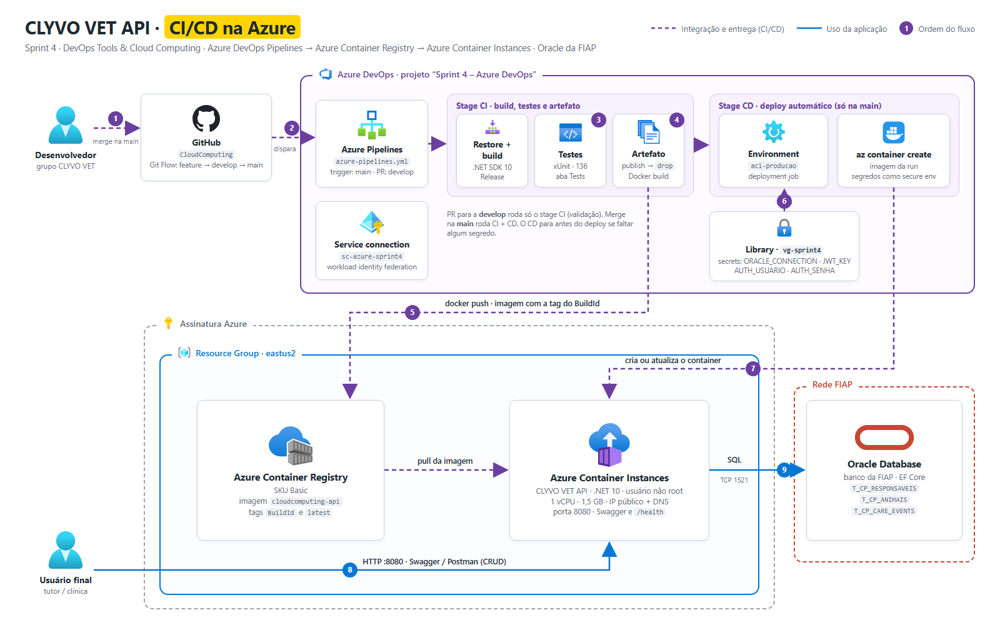

# CLYVO VET API — CI/CD na Azure (Sprint 4)

Entrega da Sprint 4 de **DevOps Tools & Cloud Computing** (Challenge FIAP 2026). A API REST do CLYVO VET, em .NET 10, é compilada, testada e publicada por um pipeline YAML no **Azure DevOps** (CI) e implantada automaticamente no **Azure Container Instances** (CD), com banco **Oracle da FIAP**.

## Integrantes

| RM | Nome | Turma |
|---|---|---|
| RM562145 | Ana Carolina Pereira Fontes | 2TDSPV |
| RM563409 | João Victor Nascimento Adão | 2TDSPX |
| RM566516 | Johnny Dias Mathias Junior | 2TDSPX |
| RM563403 | Luisa Ganasevici de Abreu | 2TDSPV |
| RM562822 | Matheus Moya de Oliveira | 2TDSPV |

## Descrição da solução

O CLYVO VET apoia o monitoramento e o cuidado de cães e gatos. A API permite cadastrar **responsáveis** (tutores), **animais** vinculados a eles e **eventos de cuidado** (vacinas, consultas, medicações, exames), com CRUD completo, autenticação JWT, paginação com HATEOAS e documentação no Swagger. Os dados ficam no Oracle da FIAP.

Cada mudança de código que chega à branch `main` dispara o pipeline: o CI compila, roda os testes automáticos, publica o artefato e envia a imagem Docker ao Azure Container Registry; o CD cria ou atualiza o container no Azure Container Instances com essa imagem, entregando a API numa URL pública.

## Stack

| Camada | Tecnologia |
|---|---|
| API | .NET 10, ASP.NET Core Web API, Clean Architecture (Domain, Application, Infrastructure, Api) |
| Dados | Oracle da FIAP, EF Core 10 (`Oracle.EntityFrameworkCore`) |
| Segurança | JWT Bearer; segredos no variable group do Azure DevOps |
| Testes | xUnit, Moq, FluentAssertions, EF Core InMemory e `WebApplicationFactory` (136 testes) |
| Observabilidade | Serilog, OpenTelemetry, health check `/health` |
| Container | Docker multi-stage (`sdk:10.0` → `aspnet:10.0`), usuário não root |
| CI/CD | Azure DevOps Pipelines (YAML), Environment `aci-producao` |
| Nuvem | Azure Container Registry (Basic) e Azure Container Instances |
| Código | GitHub (Git Flow: `feature/*` → `develop` → `main`) |

## Arquitetura e fluxo CI/CD



O desenho é gerado a partir de [`docs/arquitetura.html`](docs/arquitetura.html), com os ícones oficiais da Microsoft ([Azure Architecture Icons](https://learn.microsoft.com/azure/architecture/icons/)).

| # | Etapa | Onde atua |
|---|---|---|
| 1 | O desenvolvedor faz o merge de uma mudança de código na `main` | GitHub |
| 2 | O `trigger: main` inicia o pipeline automaticamente | Azure Pipelines |
| 3 | **CI:** restore, build e testes automáticos (xUnit) | Agente `ubuntu-24.04` |
| 4 | **CI:** `dotnet publish` e publicação do artefato `drop` | Azure Pipelines (Artifacts da run) |
| 5 | **CI:** `docker build` e `push` da imagem com a tag do BuildId | Azure Container Registry |
| 6 | **CD:** o deployment job lê os segredos do variable group `vg-sprint4` | Azure DevOps (Library + Environment `aci-producao`) |
| 7 | **CD:** `az container create` cria ou atualiza o container com a imagem nova | Azure Container Instances |
| 8 | O usuário final acessa a API (Swagger) pela URL pública, porta 8080 | Navegador / Postman |
| 9 | A API grava e consulta os dados no banco | Oracle da FIAP (EF Core) |

PRs para a `develop` também rodam o CI (validação), sem deploy.

## Pipeline (`azure-pipelines.yml`)

| Stage | Etapas | Quando roda |
|---|---|---|
| **CI** — Build, Testes e Artefato | .NET SDK 10 → restore → build → testes → publish → artefato `drop` → Docker build e push no ACR | Commits na `main` e PRs para a `develop` (o push no ACR só na `main`) |
| **CD** — Deploy no ACI | Confere os segredos → busca a credencial do ACR → `az container create` com a imagem da run → mostra URL e estado | Só na `main`, depois do CI verde |

O CD para com erro **antes** do deploy se algum segredo não chegar ou se a chave JWT tiver menos de 32 caracteres; assim um container quebrado nunca substitui o que está no ar.

## Banco de dados

Oracle da FIAP, acessado pela connection string `ConnectionStrings__OracleConnection`. As tabelas são criadas pelas migrations do EF Core (`src/DotNet.Infrastructure/Migrations`):

| Tabela | Conteúdo |
|---|---|
| `T_CP_RESPONSAVEIS` | Tutores (nome, e-mail, telefone, CPF) |
| `T_CP_ANIMAIS` | Animais, ligados a um responsável |
| `T_CP_CARE_EVENTS` | Eventos de cuidado, ligados a um animal |

## Variáveis e segredos

Nenhum segredo fica no repositório. Todos estão no variable group **`vg-sprint4`** do Azure DevOps, marcados como secret, e chegam ao container como variáveis seguras do ACI (não aparecem no portal):

| Variable group | Variável no container | Para quê |
|---|---|---|
| `ORACLE_CONNECTION` | `ConnectionStrings__OracleConnection` | Conexão com o Oracle |
| `JWT_KEY` | `Jwt__Key` | Assinatura dos tokens (32+ caracteres) |
| `AUTH_USUARIO` / `AUTH_SENHA` | `Auth__Usuario` / `Auth__Senha` | Credenciais do login |
| — | `Swagger__Habilitado=true` | Expõe o Swagger no ACI (não é segredo) |

A credencial do ACR é buscada na hora do deploy com `az acr credential show`, sem ficar guardada.

## Estrutura do repositório

```text
.
├── azure-pipelines.yml        Pipeline CI/CD (stages CI e CD)
├── Dockerfile                 Imagem da API (multi-stage, usuário não root)
├── .dockerignore
├── docs/
│   ├── arquitetura.html       Fonte do diagrama
│   └── arquitetura.png        Diagrama de arquitetura e fluxo CI/CD
└── src/
    ├── DotNet.Api.slnx
    ├── DotNet.Domain/          Entidades, exceções e interfaces dos repositórios
    ├── DotNet.Application/     Serviços e DTOs
    ├── DotNet.Infrastructure/  EF Core (Oracle), migrations, JWT e health checks
    ├── DotNet.Api/             Controllers, middlewares, HATEOAS e Program.cs
    ├── DotNet.Api.UnitTests/
    └── DotNet.Api.IntegrationTests/
```

## Como executar

### Pré-requisitos

- .NET SDK 10
- Docker
- Azure CLI (`az`), para conferir os recursos

### 1. Testes

```bash
dotnet test src/DotNet.Api.slnx
```

### 2. Imagem Docker local

```bash
docker build -t cloudcomputing-api .
docker run --rm -p 8080:8080 \
  -e ConnectionStrings__OracleConnection="<connection string do Oracle>" \
  -e Jwt__Key="<chave com 32+ caracteres>" \
  -e Auth__Usuario="<usuario>" -e Auth__Senha="<senha>" \
  -e Swagger__Habilitado=true \
  cloudcomputing-api
```

Swagger em `http://localhost:8080/swagger` e health check em `http://localhost:8080/health`.

### 3. Deploy pelo pipeline

1. No Azure DevOps, ter a service connection `sc-azure-sprint4`, o variable group `vg-sprint4` (com os segredos da tabela acima) e o Environment `aci-producao`.
2. Fazer o merge de uma mudança de código na `main` (`feature/*` → `develop` → `main`).
3. Acompanhar a run em Pipelines; ao fim do CD, conferir:

```bash
az container show -g rg-sprint4-rm562822 -n aci-cloudcomputing-rm562822 \
  --query "{estado:instanceView.state, imagem:containers[0].image}" -o table
curl http://cloudcomputing-rm562822.eastus2.azurecontainer.io:8080/health
```

## Endpoints principais

Login em `POST /api/auth/login`; as demais rotas, exceto `/` e `/health`, exigem `Authorization: Bearer <token>`.

| Recurso | Rotas |
|---|---|
| Raiz | `GET /` (nome, versão e links) |
| Responsáveis | `GET/POST /api/responsaveis` · `GET/PUT/DELETE /api/responsaveis/{id}` · `GET /api/responsaveis/cpf/{cpf}` |
| Animais | `GET/POST /api/animais` · `GET/PUT/DELETE /api/animais/{id}` · `GET /api/animais/rga/{rga}` |
| Eventos de cuidado | `GET/POST /api/care-events` · `GET/PUT/DELETE /api/care-events/{id}` · `PATCH /api/care-events/{id}/complete` |
| Saúde | `GET /health` (conexão com o Oracle) |

## Segurança

- Nenhuma credencial versionada: segredos só no variable group, como secret.
- Segredos chegam ao container por `--secure-environment-variables`.
- Container roda com usuário sem privilégios (`USER 1654`).
- O `.gitignore` cobre `.env`, `bin/`, `obj/` e logs.
